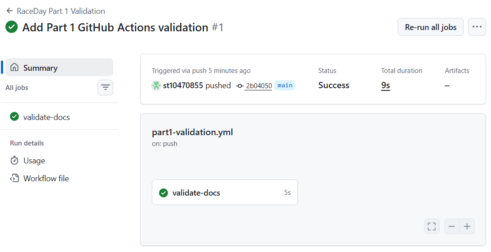
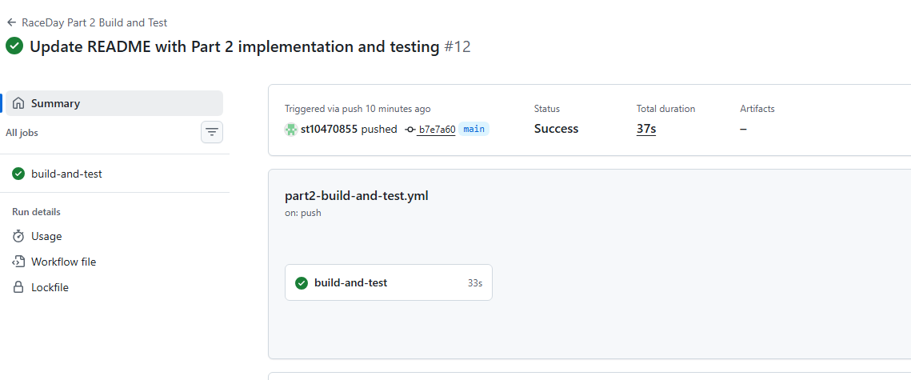

# RaceDay

## System Description

RaceDay is a full-stack event-management system designed for South African road running, walking, and cycling events.

The system supports the management of athletic events, categories, participant enrolments, and race results. The project is developed in three parts using a shared GitHub repository.

- **Part 1:** System planning, database design, SQL implementation, and documentation.
- **Part 2:** RESTful API development, authentication, role-based access, and automated testing.
- **Part 3:** Planned MVC user interface and integration with the API.

## User Roles

### Organiser

Organisers manage the events assigned to them. Their functionality includes:

- Creating, viewing, updating, and deleting events.
- Managing event categories.
- Viewing enrolments for their events.
- Recording participant results.

### Participant

Participants use RaceDay to discover events and track their participation. Their functionality includes:

- Registering an account and logging in.
- Browsing available events.
- Enrolling in events using available categories.
- Viewing their own enrolments.
- Viewing their own race results.
- Viewing and updating their profile.

Role-based access is enforced by the Part 2 API. An MVC interface is planned for Part 3.

## Part 1 — Planning and Database Design

Part 1 established the planning and database foundation for RaceDay.

### Database Design

The project uses Microsoft SQL Server. The database is named `RaceDayDB` and includes the following main tables:

1. `Role`
2. `User`
3. `Organizer`
4. `Participant`
5. `Event`
6. `Category`
7. `EventEnrolment`
8. `Result`

The database design includes primary keys, foreign keys, validation constraints, and sample data to support the project requirements.

### Part 1 Documentation

The main documentation files are stored in the `docs` folder.

**Database design and implementation**

- [RaceDay ERD](docs/RaceDay_ERD.png)
- [RaceDay Database SQL Script](docs/RaceDay_Database.sql)
- [Database Setup Guide](docs/Database_Setup_Guide.md)
- [Database Verification Guide](docs/Database_Verification_Guide.md)
- [Database Verification Queries](docs/Database_Verification_Queries.sql)
- [Database Design Decisions](docs/Database_Design_Decisions.md)
- [Data Dictionary](docs/Data_Dictionary.md)
- [SQL Implementation Notes](docs/SQL_Implementation_Notes.md)
- [Database Test Cases](docs/Part1_Database_Test_Cases.md)

**API planning**

- [RaceDay API Endpoint Plan](docs/RaceDay%20API%20Endpoint%20Plan.pdf)
- [API Design Notes](docs/API_Design_Notes.md)
- [API Role Access Matrix](docs/API_Role_Access_Matrix.md)

**Project documentation**

- [Project Structure Guide](docs/Project_Structure_Guide.md)
- [Roles and Permissions Guide](docs/Roles_and_Permissions_Guide.md)
- [Part 1 Requirements Checklist](docs/Part1_Requirements_Checklist.md)

### Part 1 Validation

The Part 1 GitHub Actions workflow validates that required documentation files are present in the repository.

Workflow file: `.github/workflows/part1-validation.yml`

### Part 1 Demonstration

The Part 1 demonstration video is available on YouTube as an unlisted video.

[Watch the RaceDay Part 1 Demonstration](https://www.youtube.com/watch?v=XwXIHUkcRnQ)

## Part 2 — RESTful API Development

Part 2 implements the RaceDay RESTful API using C#, ASP.NET Core Web API, Entity Framework Core, and Microsoft SQL Server.

### Implemented Functionality

**Authentication and profiles**

- User registration and login.
- Logout and session management.
- Password hashing.
- Viewing and updating the logged-in user's profile.
- Role-based access for Organisers and Participants.

**Events and categories**

- Retrieving events and individual event details.
- Creating, updating, and deleting events with organiser permissions and ownership checks.
- Retrieving and managing event categories with access controls.

**Enrolments and results**

- Participants can enrol in events and view their own enrolments.
- Organisers can view enrolments for their events.
- Organisers can record race results.
- Participants can view their own results.

### Technologies Used

- C#
- ASP.NET Core Web API (.NET 8)
- Entity Framework Core
- Microsoft SQL Server
- Swagger UI
- xUnit automated testing
- GitHub Actions

### Running the API Locally

1. Install Visual Studio 2022 with the .NET 8 development workload.
2. Install or configure SQL Server and ensure the required `RaceDayDB` database is available.
3. Clone the RaceDay repository.
4. Open `Part2/RaceDay.Part2/RaceDay.Part2.sln` in Visual Studio.
5. Check the `RaceDayConnection` connection string in `appsettings.json` and update it to match your SQL Server instance.
6. Set `RaceDay.API` as the startup project.
7. Run the application.
8. Open the Swagger URL displayed by the application to inspect and test the API endpoints.

Database configuration may need to be adjusted for the local environment.

### Automated Testing

The Part 2 solution includes xUnit tests for API access control, authentication, validation, and selected event functionality.

To run the tests in Visual Studio:

1. Open the Part 2 solution.
2. Open **Test Explorer**.
3. Select **Run All Tests**.

The automated test suite contains 12 tests, which passed in the latest local test run.

### Part 2 Demonstration

[Watch the RaceDay Part 2 RESTful API Demonstration](https://youtu.be/HboT0Z07kxw)

The demonstration presents the API functionality, including authentication, event management, categories, enrolments, results, and Swagger.

### Continuous Integration

GitHub Actions automatically restores dependencies, builds the Part 2 solution, and runs the automated tests on pushes and pull requests.

- [Part 2 GitHub Actions Workflow](https://github.com/st10470855/RaceDay/actions/workflows/part2-build-and-test.yml)
- [RaceDay GitHub Repository](https://github.com/st10470855/RaceDay)

The workflow provides automated validation of the Part 2 solution.

## Part 3 — Future Development

Part 3 is planned to introduce an ASP.NET Core MVC user interface that integrates with the RaceDay API.

Planned functionality includes:

- User-friendly registration and login pages.
- Event browsing and event details.
- Participant enrolment and personal results pages.
- Organiser event and category management screens.
- Organiser enrolment and result management screens.
- Integration between the MVC interface and the RESTful API.

## Version Control

Git and GitHub are used to maintain the RaceDay project history. GitHub Actions workflows support automated validation of the project as development progresses.

## Conclusion

RaceDay is being developed in stages, beginning with database design and planning in Part 1, followed by RESTful API implementation and automated testing in Part 2. Part 3 will focus on the MVC user interface and integration with the API.

The repository contains the project documentation, implementation, testing resources, and demonstration videos for the completed stages.
